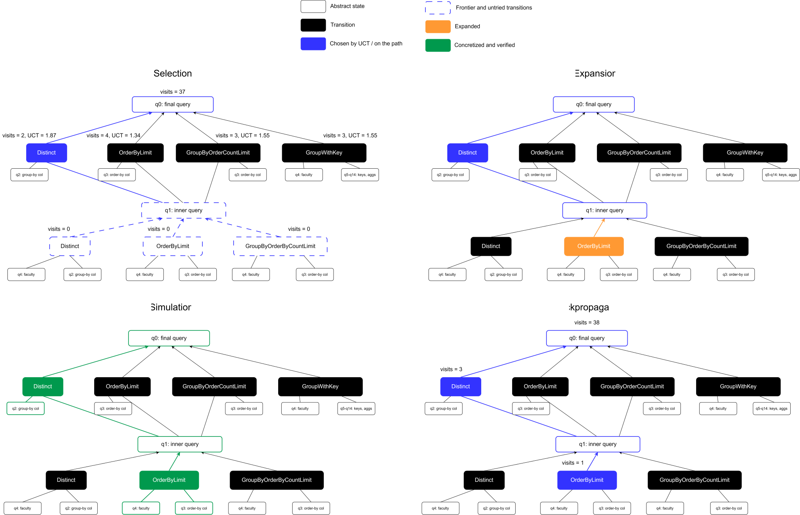

## Citation

> This project builds on **Foresighter**, the presynthesis framework from
> Dong et al., *Presynthesis: Towards Scaling Up Program Synthesis with
> Finer-Grained Abstract Semantics* (PLDI 2026, [arXiv:2604.13290](https://arxiv.org/abs/2604.13290)).
> The offline AFTA construction, reachability oracle, slicing, SQL semantics and the
> original bottom-up search (`synthesize_with_slicing.hpp`) are their work,
> used under the MIT License.

```bibtex
@misc{dong2026presynthesis,
  title         = {Presynthesis: Towards Scaling Up Program Synthesis with Finer-Grained Abstract Semantics},
  author        = {Dong, Rui and Wu, Qingyue and Ding, Danny and Guo, Zheng and Ji, Ruyi and Wang, Xinyu},
  year          = {2026},
  eprint        = {2604.13290},
  archivePrefix = {arXiv},
  primaryClass  = {cs.PL},
  note          = {To appear in PLDI 2026}
}
```

## My Contribution

I designed and implemented an MCTS-based search over Foresighter's AFTA slices:
- `algorithms/top_down_mcts.hpp`: the MCTS search
- `algorithms/top_down_mcts_pseudocode.txt`: pseudocode for the MCTS search
- path-context (`pathHash`) statistics, Merkle-hashed concrete candidate pooling,
  and the benchmark comparison against the original search

## Background

Synthesis-based SQL query optimization provides many advantages over rule-based optimization. Unlike rule-based optimizers such as Apache Calcite's HepPlanner, which rely on a set of human-written or automatically discovered rewrite rules to replace components of a query with counterparts that lead to a semantically equivalent query likely to run faster, synthesis-based optimization approaches search for the fastest rewrite within a space representing all queries that are consistent with the given query on all test inputs, bounded by depth and cost limits. Not only do these approaches not depend on direct human expertise to be effective, but they are also able to identify new query patterns that are not encompassed by rules. To search this space within a feasible amount of time, synthesizers leverage abstract semantics to prune groups of programs whose behavior is fundamentally inconsistent with that of a given query, with finer abstraction granularity leading to greater pruning potential. However, as abstract semantics become finer-grained, the cost of pruning generally rises drastically, as the state space can easily explode in size. To combat this "FTA-bloat" phenomenon, which can significantly hinder on-demand rewrite synthesis, the presynthesis-based synthesis framework Foresighter introduces an offline presynthesis phase which computes and stores on disk an abstract finite tree automaton (AFTA) representing any query on any input in a considered space and a reachability oracle which allows said AFTA to be quickly pruned during synthesis (Dong et al., 2026). In this AFTA, states represent abstract values (e.g., constraints on a table's row count, column count or column types), transitions apply SQL operators under abstract semantics, and each query corresponds to a tree of transitions, or run. When online, Foresighter uses its oracle to extract a sub-FTA, or slice, containing every candidate rewrite whose abstract behavior is consistent with the given query. This slice can then be searched over to find the fastest rewrite under concrete semantics.

## Problem

Finding the fastest rewrite within a slice cannot be treated as a standard shortest-path problem. When basing the search on a direct performance metric such as execution time, the cost of each transition becomes dependent on the running path of edges taken. This immediately rejects any application of shortest-path algorithms such as Dijkstra's algorithm or A*, which either require the globally optimal solution to be built from locally optimal solutions or an admissible heuristic. The fastest complete rewrite will not necessarily extend from the fastest subprograms, nor does there exist any known admissible heuristic for execution time.

The previous algorithm meant to search the slice concretized the slice bottom-up, continuously updating a running fastest rewrite that was returned at the end. Whenever a final concrete state was produced, the concretization process paused and all accepting runs or queries were immediately enumerated to gauge both correctness and execution speed as compared to that of the baseline query.

Although no algorithm can guarantee the fastest rewrite without, in the worst case, timing every candidate, this algorithm could potentially be sped up to save a significant amount of time in practice, especially on particularly large databases. Instead of simply iterating through the slice bottom-up, the algorithm could take advantage of the performance results of enumerated queries to prioritize searching over promising abstract subtrees. That way, it would not waste as much time concretizing regions of the slice that most likely do not contain promising rewrites, and reinforce its own search by continuously generating and taking in its own feedback.

Hence, I sought to develop an algorithm that could find rewrites within a slice that are as fast as those found by the original algorithm, but in significantly less time.

## Approach

In my early efforts adapting classic shortest-path algorithms and the search space itself, I inevitably ran into roadblocks concerning time and space complexity. This led me to understand the problem as I do today, and begin digging in a new direction. I was particularly interested in framing the problem as a multi-armed bandit problem. The more I researched the multi-armed bandit problem, the more I came to see its relevance to program synthesis. I was especially intrigued by how Monte Carlo tree search (MCTS) could balance exploiting empirically promising moves with exploring relatively unknown moves (Coulom, 2007).

MCTS is typically applied to board games such as Go, chess and others whose mid-match states can be represented by game trees with massive branching factors, but I reasoned it could be adapted to search over a slice since AFTAs are directed acyclic hypergraphs, meaning states only transition in one direction and often have many children; the algorithm needs no heuristic and is asymmetric and stoppable anytime, which suits it for searching over a black box space focused on query performance; and patterns of arranging SQL correlate with query speed, as evidenced by the effectiveness of optimizers like Apache Calcite's HepPlanner that rewrite relational algebra trees deterministically using rules.

## Algorithm

When I began devising a way to adapt MCTS, I had to first decide whether to search over a complete concrete finite tree automaton (CFTA) generated from the slice or to search over the slice, concretizing the portions needed to evaluate each playout's results. I determined that searching over the slice would yield faster rewrites in less time since associating abstract semantics, instead of concrete semantics which far outnumber them, with performance-based statistics would be more conducive to statistical convergence as the algorithm runs. In other words, by shrinking the algorithm's moveset using abstract semantics, which condense groups of programs based on shared behavior, I would make it more likely that selected moves would sooner point to their true expected values, allowing the algorithm to more quickly establish patterns of exploitation that lead to the fastest rewrite. By only concretizing the regions of the CFTA that were relevant, which could also be reused across iterations, I would also save significant time and space. I decided to set my reward equal to the median execution time of the baseline query divided by the median execution time of a candidate query (both determined using the same database) minus 1, and the exploration constant of my Upper Confidence Bounds applied to Trees (UCT) formula (Kocsis & Szepesvári, 2006) equal to c = √2 (Auer et al., 2002). Since my reward function was unbounded, I was concerned over whether a constant would make exploration obsolete in the case that certain transitions had extremely large exploitation factors, but in separate tests normalizing reward and scaling the exploration constant based on standard deviation of rewards, I did not find any meaningful improvements over c = √2. Ultimately, I wrote an algorithm that navigates the slice to collect a skeleton of abstract transitions that is concretized to generate multiple corresponding queries, whose average reward is backpropagated.



Breaking down each phase:
1. Selection: The algorithm uses UCT to enqueue one root abstract state and then repeatedly enqueues the tail states of the UCT-maximizing abstract transition of the next-in-line state, down to states with at least one unvisited transition. Chosen transitions are added to the backpropagation path and a hashmap keying chosen outgoing transition on state.

2. Expansion: One of the border states’ unvisited transitions is randomly expanded, meaning it gets added to the backpropagation path and head-to-transition hashmap and a playout begins on each of its tails. Playouts also begin on the heads of all the other unvisited transitions, except the head corresponding to the expanded transition. "Playouts" here refer to sub-playouts of the overarching playout whereby the space is traversed to complete the skeleton of transitions.

3. Simulation: During a playout, transitions from the previous abstract tails are repeatedly added to the head-to-transition hashmap down to leaf abstract states. Once all playouts finish, the algorithm uses top-down dynamic programming to collect all the root abstract state’s concrete states and terms by using the head-to-transition hashmap, a memo that keys Merkle hash on abstract state ID, and a global hashmap that keys concrete states and their terms on Merkle hash.

Base case: Memoize the leaf abstract state’s ID and Merkle hash (symbol + order) and return the hash.

Inductive step:
If this abstract state’s ID already exists in the memo, return its Merkle hash.
Recursively call on the tails of this state's assigned transition and form the Merkle hash for this state by combining its symbol and order with the Merkle hashes they return. Collect all the tails' concrete states and terms.
If this state’s Merkle hash doesn’t exist in the global hashmap, form new concrete states and terms from running the Cartesian products of the tails’ concrete states through concrete semantics and key those new states on the hash.
Memoize the state’s ID and Merkle hash and return the hash.

All of the root state’s terms are turned to SQL strings. Those that pass CEGIS contribute to the sum of rewards and update the fastest seen query if needed. The average reward is returned.

4. Backpropagation: The final reward is backpropagated to all abstract transitions in the backpropagation list, and the root abstract state.

## Results

In my tests comparing the performances of my algorithm and the original algorithm under the same time limit, I found mixed results. On smaller benchmarks, my algorithm was able to compete with and occasionally find faster rewrites than those found by the original algorithm. However, on larger benchmarks, my algorithm tended to find rewrites whose performance was close to, but below, that of the rewrites found by the original algorithm. In my experiments testing the effects of normalizing my reward function, scaling my exploration constant based on seen rewards and more harshly penalizing the rewards of queries that did not pass CEGIS, I did not find significant improvements.

## Future Work

Moving forward, I believe that making playouts more realistic by guiding them with common Apache Calcite rules could be worth exploring, as it could generally improve the rewards to backpropagate and therefore accelerate statistical convergence.

## Acknowledgments

Parts of this work were assisted by Claude (Anthropic) via Claude Code. It was used for code review and debugging (including finding and fixing a UCT visit-count bug), adapting my implementation to the existing Foresighter codebase, preparing this trimmed repository, and feedback on this write-up. The algorithm's design is my own. I reviewed all AI-generated changes.

## References

- Auer, P., Cesa-Bianchi, N., & Fischer, P. (2002). *Finite-time Analysis of the Multiarmed Bandit Problem.*\
  Machine Learning, 47(2–3), 235–256.
- Coulom, R. (2007). *Efficient Selectivity and Backup Operators in Monte-Carlo Tree Search.*\
  Computers and Games (CG 2006), LNCS 4630, 72–83. Springer.
- Kocsis, L., & Szepesvári, C. (2006). *Bandit Based Monte-Carlo Planning.*\
  Machine Learning: ECML 2006, LNCS 4212, 282–293. Springer.

<details>
<summary>BibTeX</summary>

```bibtex
@inproceedings{coulom2006mcts,
  author    = {Coulom, R{\'e}mi},
  title     = {Efficient Selectivity and Backup Operators in {Monte-Carlo} Tree Search},
  booktitle = {Computers and Games (CG 2006)},
  series    = {LNCS}, volume = {4630}, pages = {72--83},
  publisher = {Springer}, year = {2007}
}

@inproceedings{kocsis2006uct,
  author    = {Kocsis, Levente and Szepesv{\'a}ri, Csaba},
  title     = {Bandit Based {Monte-Carlo} Planning},
  booktitle = {Machine Learning: ECML 2006},
  series    = {LNCS}, volume = {4212}, pages = {282--293},
  publisher = {Springer}, year = {2006}
}

@article{auer2002ucb,
  author  = {Auer, Peter and Cesa-Bianchi, Nicol{\`o} and Fischer, Paul},
  title   = {Finite-time Analysis of the Multiarmed Bandit Problem},
  journal = {Machine Learning}, volume = {47}, number = {2--3},
  pages   = {235--256}, year = {2002}
}
```

</details>
